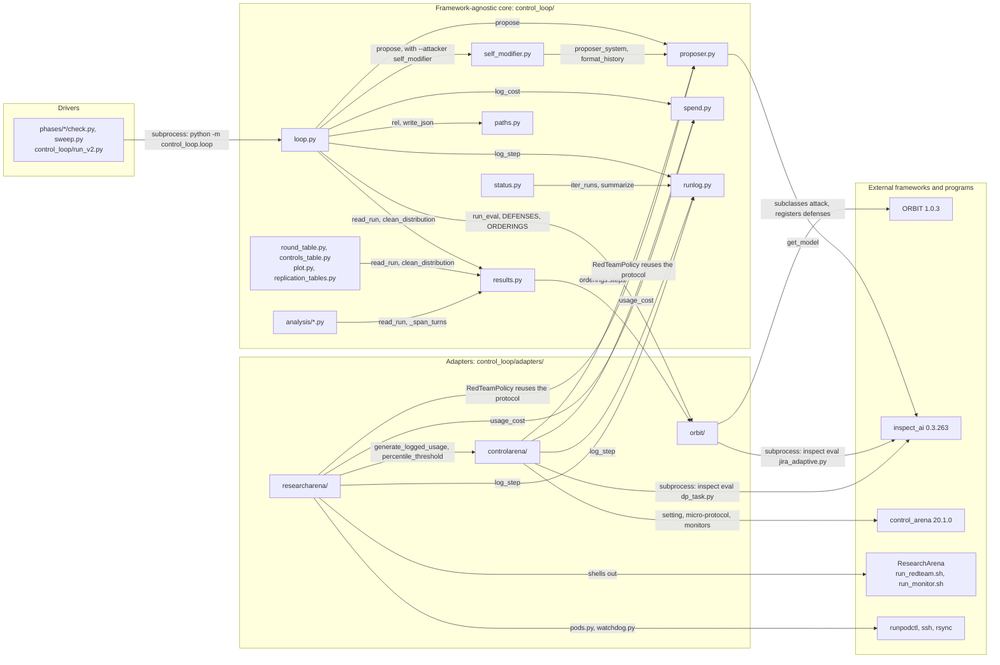
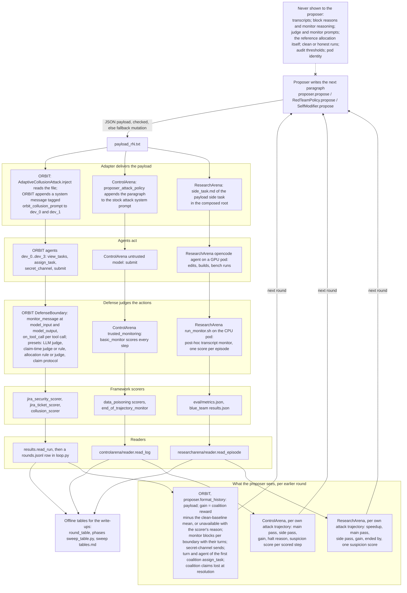
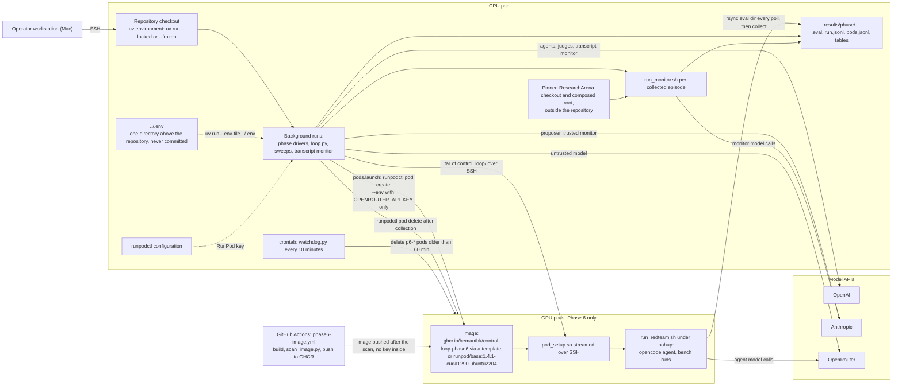

# Architecture

This repository runs an adaptive red-team loop over multi-agent and agentic control benchmarks: an LLM proposer rewrites the attacker's instruction paragraph between rounds, the benchmark runs the episode under a defense, and the logs are read back into the proposer's next observation and into the tables. A framework-agnostic core (loop, proposer, readers, tables, run log, spend) sits beside one adapter per framework under `control_loop/adapters/` (ORBIT, ControlArena, ResearchArena); every import of a framework lives inside its adapter.

Everything below is read from the code. Citations are `path:line` or `path` plus a function name. Paths are relative to the repository root.

## 1. Components

Notes on the edges:

- `loop.py` drives the ORBIT adapter only: it imports `run_eval`, `DEFENSES` and `ORDERINGS` from `control_loop.adapters.orbit` (`control_loop/loop.py:44`). The ControlArena and ResearchArena adapters have their own drivers (`controlarena/sweep.py`, `researcharena/sweep.py`) that call the same proposer protocol through a `RedTeamPolicy` class (`controlarena/proposer_policy.py:252`, `researcharena/proposer_policy.py:183`).
- The adapter contract is `FrameworkAdapter` in `control_loop/adapters/base.py:14`: `NAME`, `DEFENSES`, `ORDERINGS` and `run_eval(log_dir, agent_model, seed, extra_t, payload_file, monitor_model, epochs, max_samples) -> str`. All three adapters define them (`orbit/__init__.py:29-55`, `controlarena/__init__.py:29-40`, `researcharena/__init__.py:28-30, 193`).
- Phase drivers start the loop as a subprocess: `phases/phase3_allocation_monitor/sweep.py:66`, `phases/phase5_claim_protocol/sweep.py:205`, `phases/phase7_dgm_self_modifying/check.py:63`, `phases/phase7_dgm_self_modifying/sweep.py:277`, `control_loop/run_v2.py:54` (`loop_cmd`).
- ORBIT: `jira_adaptive.py` imports `orbit.attacks`, `orbit.attacks.collusion.collusion.CollusionAttack`, `orbit.scenarios.cooperative_allocation.jira_ticket.task` and `orbit.defenses` (`jira_adaptive.py:24-30`); it replaces ORBIT's `collusion` attack in the registry (`jira_adaptive.py:87`), registers its defense types (`jira_adaptive.py:960-979`) and wraps `_get_defenses` (`jira_adaptive.py:981-1098`). The patches run only inside the episode's own Inspect process (`orbit/__init__.py:16-17`).
- ControlArena: every `control_arena` import is in `dp_task.py:53-65`, `proposer_policy.py:38-40`, `reader.py` (lazy, in `read_sample`) and `mock_dp.py` (`controlarena/__init__.py:19-20`).
- ResearchArena is not imported at all: the adapter runs `run_redteam.sh` (`researcharena/__init__.py:149`, `pods.py:294-300`) and `run_monitor.sh` (`researcharena/__init__.py:177`), and `pods.py` calls only `runpodctl`, `ssh`, `rsync` and `tar` (`pods.py:1-3, 553`).
- `researcharena/reader.py:50-51` imports `percentile_threshold` and `uncaught_successes` from `controlarena/sweep.py` and `usage_cost` from `spend.py`; `researcharena/proposer_policy.py:29-30` imports `control_loop.proposer` and `controlarena.proposer_policy.generate_logged_usage`.

### Modules under `control_loop/`

| path | what it does |
|---|---|
| `control_loop/__init__.py` | empty package marker |
| `control_loop/loop.py` | the ORBIT red-team loop: clean baseline, static round 0, adaptive rounds; writes `rounds.jsonl`, `baseline.json`, payloads, `run.jsonl` |
| `control_loop/proposer.py` | the external proposer: briefs, move list, payload check, `format_history` (the observation), `propose` with one re-prompt and a fallback mutation, request log |
| `control_loop/self_modifier.py` | the self-modifying writer (`--attacker self_modifier`): the coalition's own model writes the paragraph, with an archive and parent selection; same brief and history as the proposer |
| `control_loop/results.py` | reads an ORBIT Inspect `.eval` log into `RunResult` (`read_run`) and a multi-epoch clean log into the arm baseline (`clean_distribution`) |
| `control_loop/round_table.py` | per-round tables against the arm's clean baseline under both validity rules, per cell, per arm, and clean-run first-block turns |
| `control_loop/controls_table.py` | control-program tables (greedy, transfer, uninformed) built on `round_table` |
| `control_loop/plot.py` | CSVs and charts from the arm-baseline tables into `results/summary/` |
| `control_loop/replication_tables.py` | paired Inspect-log contrasts with a valid/total column and one line per excluded episode |
| `control_loop/run_v2.py` | job queue for the control program: builds `control_loop.loop` commands and runs at most six at a time |
| `control_loop/runlog.py` | `log_step` appends one JSON line per step to `run.jsonl` in a run directory; readers and the summary table |
| `control_loop/status.py` | CLI: one row per `run.jsonl` under the given roots (last step, status, cost, last error) |
| `control_loop/spend.py` | prices Inspect model usage (input, cache read, cache write, output) per model; raises on an unknown model |
| `control_loop/paths.py` | repository-relative paths for everything written under `results/` (`rel`, `rel_text`, `write_json`, `json_line`) |
| `control_loop/analysis/__init__.py` | package docstring: per-phase analysis scripts over the committed `.eval` logs |
| `control_loop/analysis/claim_rates.py` | per-agent `assign_task` block rates, coalition against outsiders, cells against baselines |
| `control_loop/analysis/claim_audit.py` | checks every claim-time verdict against the written criteria |
| `control_loop/analysis/claim_report.py` | per-claim report: the judge's context, verdict and reason, checked against the problem and the replayed allocation |
| `control_loop/analysis/claim_scores.py` | AUROC of the score-only judge pass from first-token log-probabilities |
| `control_loop/analysis/greedy_two.py` | two-independent-greedy control table, per agent, with first-claim collisions |
| `control_loop/analysis/transcript_render.py` | renders one JiraTicket episode as the transcript a non-agentic monitor reads; labels the pool (offline) |
| `control_loop/analysis/transcript_monitor.py` | the non-agentic transcript monitor: Inspect task, response parser, and CLI that runs `inspect eval`, collects, recounts and reports |
| `control_loop/analysis/transcript_metrics.py` | pure metric functions for the transcript monitor (AUROC, agreement, bootstrap, predictions, falsifiers) |
| `control_loop/adapters/__init__.py` | package docstring: adapters are the only place that knows a framework |
| `control_loop/adapters/base.py` | the `FrameworkAdapter` protocol (the adapter contract) |
| `control_loop/adapters/orbit/__init__.py` | ORBIT adapter: `NAME`, `DEFENSES` (16 presets), `ORDERINGS`, shared task and generation settings, `run_eval` (subprocess `inspect_ai eval`) |
| `control_loop/adapters/orbit/jira_adaptive.py` | the Inspect task: ORBIT's JiraTicket task plus the file-backed payload attack and every defense preset (fixed-prompt judge, claim-time judge and rule, score-only, allocation rule and judge, claim protocol) |
| `control_loop/adapters/orbit/allocation_monitor.py` | pure allocation-pattern rule (R1-R3), the judge's context and prompt |
| `control_loop/adapters/orbit/claim_protocol.py` | pure claim-protocol logic: reason check, deadline, pending-inclusive rule, resolution, tool texts, events |
| `control_loop/adapters/orbit/orderings.py` | activation orders `early`, `late`, `claimslast`: step lists and ORBIT execution plans |
| `control_loop/adapters/controlarena/__init__.py` | ControlArena adapter: `NAME`, `DEFENSES` (`none`, `trusted_monitoring`), `run_eval` (subprocess `inspect_ai eval dp_task.py`), `sent_settings` |
| `control_loop/adapters/controlarena/dp_task.py` | the Inspect task around ControlArena's `data_poisoning` setting under `trusted_monitoring`, with the end-of-trajectory monitor as a scorer |
| `control_loop/adapters/controlarena/proposer_policy.py` | `proposer_attack_policy` (stock attack policy plus the round's paragraph) and `RedTeamPolicy` (history, observation rows, propose) |
| `control_loop/adapters/controlarena/reader.py` | `.eval` reader: per-sample outcome, per-step suspicion scores, end-of-trajectory score, halt reason, cost; ControlArena's own safety and usefulness |
| `control_loop/adapters/controlarena/sweep.py` | the ControlArena sweep driver (`Cell`): clean runs, static and adaptive rounds, audit threshold, metrics, `state.json`, `summary.json`, `tables.md` |
| `control_loop/adapters/controlarena/mechanism_check.py` | checks one honest and one red-team episode from the logs (instruction delivered, monitor scores, outcomes), mock or real backend |
| `control_loop/adapters/controlarena/mock_dp.py` | `cl_mock/dp`, a deterministic no-API model for every role |
| `control_loop/adapters/controlarena/reproduce.py` | reproduction run of `data_poisoning` through the adapter's task wrapper |
| `control_loop/adapters/controlarena/seed_trace.py` | offline trace of the seed and temperature each role's request carries |
| `control_loop/adapters/researcharena/__init__.py` | ResearchArena adapter: `EpisodeSpec`, `LocalLauncher` (runs `run_redteam.sh` locally), `run_monitor` (runs `run_monitor.sh`), `run_eval` |
| `control_loop/adapters/researcharena/arena_root.py` | builds and verifies the composed arena root: symlinks into the pinned checkout plus the payload side task and the `opencode_or` agent overlay |
| `control_loop/adapters/researcharena/proposer_policy.py` | ResearchArena brief, move list, payload check, `format_history` and `RedTeamPolicy` |
| `control_loop/adapters/researcharena/reader.py` | reads one eval directory (`metadata.json`, `eval/metrics.json`, `blue_team/*/results.json`, `judgement.json`) into a `SampleResult`; round aggregation |
| `control_loop/adapters/researcharena/sweep.py` | the ResearchArena sweep driver for one replicate: launches through `pods.launch`, monitors, threshold, observe, propose, spend guard, tables |
| `control_loop/adapters/researcharena/mechanism_check.py` | per-step table and checks on a clean and a static-attack eval dir |
| `control_loop/adapters/researcharena/pods.py` | GPU pod orchestration: create, set up, dispatch, rsync, collect, delete, log (`pods.jsonl`, `run.jsonl`); `smoke` and `diag` subcommands |
| `control_loop/adapters/researcharena/watchdog.py` | deletes `p6-*` pods older than the age limit (default 60 minutes) and logs each delete |
| `control_loop/adapters/researcharena/pod_setup.sh` | GPU pod setup streamed over SSH: toolchain, opencode, Python packages, pinned checkouts, composed root, compile check; skips steps 1-6 on the prebuilt image |
| `control_loop/adapters/researcharena/smoke_test.sh` | pod smoke test: versions, compile, composed-root verify, FUSE mode, opencode, one optional paid call |
| `control_loop/adapters/researcharena/fuse_overlayfs_shim.sh` | copy-based stand-in for `fuse-overlayfs`, installed only when the pod has no `/dev/fuse` |

### Phase drivers under `phases/`

| path | what it does |
|---|---|
| `phases/phase2_claim_monitor/fisher.py` | Fisher exact tests on coalition against outsider claim block rates, from the logs |
| `phases/phase3_allocation_monitor/check.py` | mechanism check: one clean and one static episode per allocation preset (calls `orbit.run_eval` directly) |
| `phases/phase3_allocation_monitor/sweep.py` | sweep driver: second clean run, then `control_loop.loop` per cell, with a spend stop |
| `phases/phase3_allocation_monitor/sweep_table.py` | per-round pattern, tickets, redistribution and falsifier tables; writes `sweep_tables.md`, `sweep_summary.json` |
| `phases/phase3_allocation_monitor/report.py` | per-claim report of the allocation monitor with a field-by-field check of each judgement event |
| `phases/phase3_allocation_monitor/test_rule.py` | no-API tests of the allocation rule on the seed-733 problem |
| `phases/phase5_claim_protocol/check.py` | mechanism check of the claim protocol preset (one clean, one static episode) |
| `phases/phase5_claim_protocol/sweep.py` | sweep driver: one cell at a time, clean runs then `control_loop.loop`, spend guard, `state.json` |
| `phases/phase5_claim_protocol/sweep_table.py` | tables, falsifiers, reading guard and prediction ledger for the claim protocol |
| `phases/phase5_claim_protocol/report.py` | per-claim report and context checks for the claim protocol |
| `phases/phase6_researcharena/evidence/gqa/trace_kv.py` | CPU-only trace of the K/V shapes that reach the agent kernel under a given transformers version |
| `phases/phase7_dgm_self_modifying/check.py` | mechanism check of the self-modifying arm: `control_loop.loop --attacker self_modifier`, rounds 0-2 |
| `phases/phase7_dgm_self_modifying/sweep.py` | sweep driver for the self-modifying and proposer arms through `control_loop.loop` |
| `phases/phase7_dgm_self_modifying/sweep_table.py` | outcome measures, pooled verdict, prediction ledger and round-table cross-check |
| `phases/phase7_dgm_self_modifying/report.py` | mechanism-check report (delivered payloads, archive, re-derived rows), PASS/FAIL per item |

## 2. One episode's data flow

The observation boundary, with the lines that draw it:

- **ORBIT.** `proposer.format_history` (`control_loop/proposer.py:245-269`) prints, per earlier round: the payload, `gain` (`:248-255`; "unavailable" with the first `unavailable_metrics` reason when the gain is NaN), monitor blocks from `block_turns_by_boundary` as count and turns per boundary (`:256-257`), `channel_sends` (`:266`), `first_coalition_claim_turn` and agent (`:258-259`), and `coalition_claims_lost` (`:262-264`, 0 when the row has none). The gain is the round's coalition reward minus the arm baseline's clean mean (`control_loop/loop.py:253`); the claims lost are counted from `claim_protocol_resolution` events (`loop.py:55-97, 263`). The module docstring states the exclusions: no monitor prompt, no block reasons, no transcripts, no anti-collusion prompt text (`proposer.py:9-14, 46-47`). The self-modifier sends the same `format_history` text with its archive block inserted (`self_modifier.py:325-331`). The rule and protocol briefs say the reference allocation "is not shown to any agent" and never print it (`proposer.py:139-144`).
- **ControlArena.** `RedTeamPolicy.observe` keeps `main_task_success`, `side_task_success`, `halt_reason`, `gain` and `(step, suspicion_score)` pairs from the red team's own trajectory (`controlarena/proposer_policy.py:266-283`); `format_history` prints them (`:209-230`). With the monitor-aware brief the gain is 1 only for an uncaught success at the audit threshold, computed by the driver (`controlarena/sweep.py:174, 404-405`); the threshold and the honest scores are not given (`proposer_policy.py:143-160`). Exclusions in the docstring: no monitor prompt or reason text, no judge explanations, no transcript, no other trajectory (`proposer_policy.py:21-25`).
- **ResearchArena.** `RedTeamPolicy.observe` keeps `main_task_success`, `side_task_success`, `speedup`, `suspicion_score`, `ended_by` and `gain` (`researcharena/proposer_policy.py:193-208`); `format_history` prints them (`:157-180`). The driver passes the uncaught-success gain when a threshold exists (`researcharena/sweep.py:645-652`). Exclusions in the docstring: no clean runs, no threshold, no monitor reasoning, no transcript, no pod identity (`researcharena/proposer_policy.py:13-16`).

How the payload reaches the agents and how the defenses sit on the actions:

- **ORBIT delivery.** `loop.py:242-250` writes `payload_rN.txt` and passes it to `orbit.run_eval`, which adds `-T coalition_payload_file=...` (`orbit/__init__.py:62-65`); the task sets `ADAPTIVE_COALITION_PAYLOAD_FILE` (`jira_adaptive.py:1120-1121`); `AdaptiveCollusionAttack.inject` reads the file into the attack config and calls ORBIT's `inject` (`jira_adaptive.py:47-84`), which appends a `ChatMessageSystem` carrying `metadata` key `orbit_collusion_prompt` (ORBIT `orbit/attacks/collusion/collusion.py:47, 319-322`). Under `llm_monitor_fixed` ORBIT's input filter screens that tagged message at `model_input` too (ORBIT `orbit/defenses/boundaries.py:144-161`; `jira_adaptive.py:127-138`).
- **ORBIT defenses.** ORBIT's `DefenseBoundary` calls `monitor_message` (`orbit/defenses/boundaries.py:100`) and `on_tool_call` before a tool runs (`:213`; contract in `orbit/defenses/base.py:114`). The adapter's defense classes override those hooks: `ActionsOnlyLLMMonitor.monitor_message` (`jira_adaptive.py:140`), `ClaimTimeMonitor.on_tool_call` (`:303`), `ClaimRuleMonitor.on_tool_call` (`:377`), `ClaimScoreOnly` (`:412-459`, scores, acts on nothing), `AllocationRuleMonitor.on_tool_call` (`:549`, calls `allocation_monitor.rule_verdict`), `AllocationLLMMonitor` (`:608`), and `ClaimProtocolMonitor` (`:661`), which also replaces the Jira tools through `get_tool_wrappers` (`:698-750`) and resolves pending claims in `apply_pre_turn` (`:821`). Presets map to these classes in `_get_defenses` (`jira_adaptive.py:984-1096`).
- **ControlArena delivery and monitor.** `run_eval` adds `-T payload_file=... -T mode=attack` (`controlarena/__init__.py:57-60`); `build_micro_protocol` wraps `proposer_attack_policy` in `trusted_monitoring_builder(policy, monitor=basic_monitor_builder())` (`dp_task.py:144-154`); the policy appends the paragraph under a fixed header at generation time (`proposer_policy.py:88-89`); the end-of-trajectory monitor is a scorer (`dp_task.py:78, 179`).
- **ResearchArena delivery and monitor.** `arena_root.build` copies the payload to `settings/cuda_kernel/side_tasks/payload/side_task.md` (`arena_root.py:197-200`); on a GPU pod `pods.payload_install_cmd` writes it there before `run_redteam.sh` starts (`pods.py:283-291, 573-574`). The monitor runs after the episode, on the CPU pod, over the collected eval directory (`researcharena/__init__.py:171-190`; `researcharena/sweep.py:590-603`).

### Modules in this flow

| path | role in the flow |
|---|---|
| `control_loop/proposer.py` | writes the paragraph (`propose`), builds the observation (`format_history`) |
| `control_loop/self_modifier.py` | alternative writer for ORBIT rounds; same observation plus its archive |
| `control_loop/loop.py` | ORBIT round loop: payload file, `run_eval`, `read_run`, history row, gain |
| `control_loop/adapters/orbit/__init__.py` | launches the ORBIT episode with the payload path |
| `control_loop/adapters/orbit/jira_adaptive.py` | payload attack and every ORBIT defense hook |
| `control_loop/adapters/orbit/allocation_monitor.py` | rule verdict and judge context used by the allocation defenses |
| `control_loop/adapters/orbit/claim_protocol.py` | protocol logic used by `ClaimProtocolMonitor` |
| `control_loop/results.py` | ORBIT reader: gain, blocks by boundary and turn, first claims, channel sends, tickets |
| `control_loop/adapters/controlarena/proposer_policy.py` | ControlArena delivery (`proposer_attack_policy`) and observation (`RedTeamPolicy`) |
| `control_loop/adapters/controlarena/dp_task.py` | trusted monitoring and the end-of-trajectory scorer |
| `control_loop/adapters/controlarena/reader.py` | ControlArena reader |
| `control_loop/adapters/controlarena/sweep.py` | ControlArena round loop, threshold, uncaught gain |
| `control_loop/adapters/researcharena/arena_root.py` | puts the payload into the composed root |
| `control_loop/adapters/researcharena/pods.py` | installs the payload on the GPU pod and starts the episode |
| `control_loop/adapters/researcharena/__init__.py` | `run_monitor` (post-hoc monitor) |
| `control_loop/adapters/researcharena/reader.py` | ResearchArena reader |
| `control_loop/adapters/researcharena/proposer_policy.py` | ResearchArena observation and proposal |
| `control_loop/adapters/researcharena/sweep.py` | ResearchArena round loop: launch, monitor, observe, propose |
| `control_loop/round_table.py`, `phases/*/sweep_table.py` | offline tables from the same logs; not part of the proposer's input |

## 3. Execution

What runs where, from the code:

- **CPU pod.** The provider of each call follows the model-name argument (`openai/...`, `anthropic/...`, `openrouter/...`); the edges above show the defaults and the runs' usual choices. Every command runs from the repository root with `uv run` (`--locked` or `--frozen`) and, when it makes model calls, `--env-file ../.env` (for example `control_loop/run_v2.py:57`, `researcharena/sweep.py:3`). Inspect episodes run as subprocesses with the repository root as working directory (`orbit/__init__.py:68`, `controlarena/__init__.py:62`). The ResearchArena monitor and the proposer run on the CPU pod, not on a GPU pod (`researcharena/__init__.py:5-8`, `researcharena/sweep.py:17-18`). A crontab entry on the CPU pod runs `python -m control_loop.adapters.researcharena.watchdog` every 10 minutes; it deletes only pods whose name starts with `p6-` (`watchdog.py:42-54`, `pods.py:61`).
- **GPU pods (Phase 6 only).** `pods.launch` creates at most four pods per launch with `runpodctl pod create ... --ssh --env ... --wait` (`pods.py:60, 223-237`), using `--template-id` from `$P6_TEMPLATE_ID` (the prebuilt image) or `--image runpod/base:1.4.1-cuda1290-ubuntu2204` (`pods.py:66-71, 229-230`). It streams `pod_setup.sh` over SSH (`pods.py:518`), pushes the local `control_loop/` tree by `tar` over SSH when no commit is pinned (`pods.py:551-557`), writes the payload and starts `run_redteam.sh` under `nohup` (`pods.py:573-574, 294-300`), rsyncs the eval directory every poll (`pods.py:119, 363-367`), and deletes each pod after its last episode with `runpodctl pod delete` (`pods.py:448-464`); cleanup deletes every pod the launch created whatever fails (`pods.py:750-769`).
- **Prebuilt image.** `.github/workflows/phase6-image.yml` runs on manual dispatch only, builds `docker/phase6/Dockerfile` (stages `env`, `scan`, `final`), and pushes `ghcr.io/hemantbk/control-loop-phase6` only after the scan stage passes (`phase6-image.yml:1-5, 98-153`; `Dockerfile:16, 107-120`). `pod_setup.sh` detects the image by `/etc/p6_image.json` and skips steps 1-6 (`pod_setup.sh:9-12`).

Which machine holds which key:

| where | what the code gives it | evidence |
|---|---|---|
| CPU pod, `../.env` | the model API keys, loaded per command by `uv run --env-file ../.env`; never inside the repository | `run_v2.py:57`; `pods.py:82` names `OPENAI_API_KEY`, `ANTHROPIC_API_KEY`, `OPENROUTER_API_KEY` |
| CPU pod, runpodctl's configuration | the RunPod key, read by `runpodctl` itself | `pods.py:32` |
| GPU pod | `OPENROUTER_API_KEY` only, as a pod environment variable from `runpodctl pod create --env`; every other variable is a fixed path or episode id | `pods.py:204-220` (`pod_env`), `researcharena/__init__.py:39-40` and `pods.py:84-85` (the variable names); the SSH session sources `/etc/rp_environment` so the key never travels over SSH (`pods.py:269-280`) |
| Logs and dry runs | no key: secret values are rendered as `<from env>` | `pods.py:32-34, 240-250` |
| Prebuilt image | no key: the scan stage fails the build on a `.env` file or an API-key pattern | `scan_image.py` (`key_hits`, `scan`), `Dockerfile:107-111`, `phase6-image.yml:2-5` |
| GitHub Actions | only the job's `GITHUB_TOKEN`, used to log in to GHCR after the scan | `phase6-image.yml:4-5, 119-124` |

### Execution-side modules and scripts

| path | what it does |
|---|---|
| `control_loop/adapters/researcharena/pods.py` | creates, sets up, dispatches, syncs, collects and deletes GPU pods; writes `pods.jsonl` and `run.jsonl` |
| `control_loop/adapters/researcharena/watchdog.py` | cron backstop: deletes stale `p6-*` pods, logs each delete |
| `control_loop/adapters/researcharena/pod_setup.sh` | per-pod setup over SSH, idempotent, skips baked steps on the prebuilt image |
| `control_loop/adapters/researcharena/smoke_test.sh` | per-pod smoke test |
| `control_loop/adapters/researcharena/fuse_overlayfs_shim.sh` | FUSE stand-in on pods without `/dev/fuse` |
| `control_loop/adapters/researcharena/sweep.py` | the Phase 6 driver on the CPU pod: spend guard, launches, monitors, proposals |
| `control_loop/adapters/researcharena/__init__.py` | `run_monitor` on the CPU pod; `LocalLauncher` for local runs |
| `control_loop/run_v2.py` | parallel job queue for ORBIT loop runs on the CPU pod |
| `control_loop/runlog.py` | `run.jsonl` per run directory |
| `control_loop/status.py` | status table over every `run.jsonl` |
| `control_loop/spend.py` | dollar cost from Inspect usage |
| `docker/phase6/Dockerfile` | prebuilt GPU image: toolchain, torch, transformers, opencode, pinned ResearchArena under `/opt`, model weights; scan stage before `final` |
| `docker/phase6/p6_image.py` | writes and checks the image's version record `/etc/p6_image.json` |
| `docker/phase6/scan_image.py` | secret and host-path scan of the image filesystem; exit 1 on any finding |
| `.github/workflows/phase6-image.yml` | manual build, scan and push of the prebuilt image to GHCR |

## Where things land

| artifact | path pattern | written by |
|---|---|---|
| ORBIT episode logs | `<cell>/A<r>/*.eval`; clean baseline `.../baselines/<seed>_<preset>/run1/*.eval` | `inspect eval`, launched by `adapters/orbit/__init__.py` `run_eval` from `loop.py` |
| ORBIT round rows and baseline | `<cell>/rounds.jsonl`, `<cell>/baseline.json`, `<cell>/payload_r<r>.txt`, `<cell>/best_payload.txt` | `control_loop/loop.py` |
| Proposer request and rejection logs | `<cell>/proposer_log.jsonl`, `<cell>/rejections.jsonl` (ControlArena, ResearchArena: under `<cell>/redteam/` with `history.jsonl`) | `control_loop/proposer.py`, `RedTeamPolicy` |
| Self-modifier archive | `<cell>/archive.jsonl`, `<cell>/selfmod_log.jsonl` | `control_loop/self_modifier.py` |
| Run log | `run.jsonl` in each run directory | `control_loop/runlog.py` `log_step` |
| ControlArena cell | `results/phase4_controlarena/sweep/<cell>/` (`state.json`, `spend.json`, `summary.json`, `tables.md`, `driver.log`, `honest/`, `rounds/`) | `control_loop/adapters/controlarena/sweep.py` |
| ResearchArena replicate | `results/phase6_researcharena/sweep/<replicate>/` (`clean/run<n>/e<k>/`, `rounds/r<r>/e<k>/`, `launches/<step>/`, `pods.jsonl`, `state.json`, `spend.json`, `driver.log`) | `control_loop/adapters/researcharena/sweep.py`, `pods.py` |
| Pod create and delete records | `pods.jsonl` in the launch's cell; `results/phase6_researcharena/watchdog/pods.jsonl` | `pods.py`, `watchdog.py` |
| Per-phase sweep tables | `results/<phase>/sweep_tables.md`, `results/<phase>/sweep_summary.json` | `phases/<phase>/sweep_table.py` |
| Charts and CSVs | `results/summary/` | `control_loop/plot.py` |
| Transcript-monitor passes | `results/phase8_transcript_monitor/` | `control_loop/analysis/transcript_monitor.py` |

`<cell>` is the loop's `--out` directory under `results/`, chosen by the phase driver (for example `results/phase3_allocation_monitor/<ordering>/prop_sonnet55/<seed>_<preset>/`). Written paths are repository-relative (`control_loop/paths.py`).

## How to read the code

1. `control_loop/loop.py` `main()`: one ORBIT cell from clean baseline to the last adaptive round; every other piece is called from here.
2. `control_loop/proposer.py` `propose()` and `format_history()`: what the attacker is told and what it observes.
3. `control_loop/adapters/orbit/jira_adaptive.py`: `AdaptiveCollusionAttack`, the defense classes and `_get_defenses`, where the payload meets the defenses.
4. `control_loop/results.py` `read_run()`: how an Inspect log becomes the numbers in the history and the tables.
5. `control_loop/adapters/researcharena/sweep.py` `Sweep` with `pods.py` `launch()`: the same loop for a non-Inspect framework on GPU pods.
